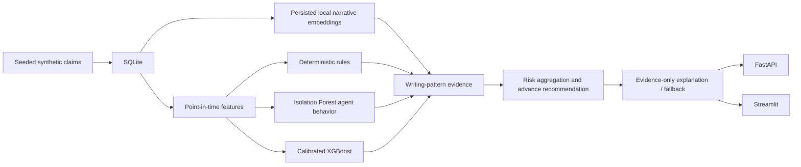

# Insurance Claim Risk Review MVP

## Problem Statement

This local MVP assesses whether insurance-claim evidence appears trustworthy enough for an advance-payment workflow. It identifies suspicious submission patterns repeated agent writing habits, semantic narrative reuse, unusual agent behavior, inconsistent evidence, and policy/document inconsistencies.

It is not an AI-authorship detector. AI-generated text is not itself fraud. Outputs are risk signals, never confirmed fraud findings, legal conclusions, coverage decisions, or payment authorizations.

## Business Objective

Provide an auditable point-in-time risk estimate and illustrative advance recommendation, routing elevated-risk claims to a human reviewer.

## MVP Status

The implemented local MVP uses synthetic relational data, SQLite, point-in-time features, Isolation Forest, persisted sentence-transformer embeddings, calibrated XGBoost, deterministic safeguards, FastAPI, Streamlit, and an optional evidence-only OpenAI explanation adapter. All data is synthetic; synthetic metrics do not represent real-world insurance performance. This is not production-ready.

## Architecture



## Synthetic Data Generation

The deterministic generator creates agents, customers, policies, contractors, claims, and dated documents with SQLite foreign keys. Normal claims have varied narratives and active, in-force policy coverage; a controlled suspicious subset includes duplicate/reused narratives, amount inflation, abnormal agent frequency, inactive policy, document-date inconsistency, contractor concentration, repeat-customer behavior, and multi-signal cases. A tiny unlabelled writing-review cohort demonstrates that reuse is a review signal, not proof of fraud.

`fraud_label` and injection metadata are training/evaluation only; they are excluded from features, rules, embedding retrieval, API output, and UI.

## Point-in-Time Feature Engineering

Features include current claim facts, prior agent/customer behavior, amount comparisons, policy consistency, documents available at submission time, duplicate evidence, and writing signals. History is updated only after every claim on the same date is evaluated. Future claims, same-day claims, the current claim, outcomes, labels, and scenario/injection fields cannot enter claim-time evidence.

## Temporal Leakage Prevention

Historical aggregates require strictly earlier submission dates. Narrative retrieval filters the local index to `submitted_date < T`, excluding self, same-day, and future candidates. The index stores only claim ID, agent ID, date, vectors, and configuration—not raw narratives, labels, scenarios, or outcomes. The model schema rejects target, scenario/injection, and post-decision columns.

## Agent Behavioral Modeling

Isolation Forest trains on eligible historical agent profiles. `agent_anomaly_scored` accompanies the numerical score so an unscored value is distinct from a genuine zero. The reviewer UI shows agent ID, score availability, and historical claim context.

## Writing-Pattern Analysis

Local `all-MiniLM-L6-v2` embeddings are generated during preparation and persisted in `data/processed/narrative_embedding_index.npz`. Live API/UI analysis reuses this local artifact rather than re-embedding 50,000 historical narratives.

Writing-pattern analysis shows maximum prior semantic similarity, average same-agent similarity, maximum other-agent similarity, highly similar prior-claim count, repeated-template indicator, and threshold-filtered prior claim IDs. It detects semantic reuse and unusual narrative behavior, not AI authorship, and never shows raw prior narratives.

## XGBoost Risk Model

XGBoost uses chronological whole-date 60%/20%/20% train/validation/test cohorts and `scale_pos_weight`. The training estimator is frozen with scikit-learn `FrozenEstimator`; sigmoid calibration is fit only on validation data. Test data is reserved for evaluation.

`fraud_probability` is always calibrated XGBoost `predict_proba` in `[0,1]`. Deterministic rule/policy safeguards are deliberately excluded from the supervised schema, keeping calibrated model probability distinct from final risk and allowing safeguards to independently require review. Artifacts persist model, schema, configuration, metrics, importance, seed, and version. `rule_risk_score` is a deterministic score, not a probability.

## Risk Aggregation

Risk begins at calibrated probability: low `<0.30`, medium `0.30–<0.70`, high `>=0.70`. Observable safeguards can elevate the final risk level without overwriting `fraud_probability`.

## Advance-Payment Decisioning

Low risk is eligible for configured percentage/cap subject to verification and business limits. Medium risk receives a limited recommendation or added verification. High risk receives `$0` automatic advance and requires human review. This is an **advance recommendation**, not an approved payment. Rules are illustrative and require business, legal, and insurance approval before production use.

## Evidence-Based LLM Explanation

The optional OpenAI adapter receives only structured, already-computed evidence. It cannot calculate or modify probability, final risk, advance, or review status. Missing `OPENAI_API_KEY` or API failure returns a deterministic local fallback. Raw narratives are not sent unnecessarily.

## FastAPI

Endpoints: `GET /health`, `GET /claims/{claim_id}`, `POST /claims/{claim_id}/analyze`, `GET /claims/{claim_id}/risk`, `GET /claims/{claim_id}/explanation`, and `GET /claims/{claim_id}/decision`.

Responses expose the evidence trail: claim → signals/rules → calibrated probability → final risk → advance recommendation → review requirement → explanation.

## Streamlit Dashboard

The dashboard provides the 50,000-claim overview, searchable claim selector, claim review, and evidence sections. It visibly separates **Calibrated model probability**, **Final risk level**, **Advance recommendation**, and **Manual-review requirement**. It displays agent behavioral evidence, writing-pattern analysis, qualifying similar claim IDs, triggered rules/review factors, and explanation.

It states: “Safeguards and business caps can require manual review independently of calibrated model probability.” Invalid IDs show “Claim not found” and cannot retain stale analysis.

## Local Setup

```bash
python3.11 -m venv .venv
source .venv/bin/activate
pip install -e '.[dev]'
```

No Docker, Kubernetes, AWS, cloud service, vector database, or other infrastructure is needed. Sentence-transformer weights must be present locally before building the index; live scoring loads them with `local_files_only=True`.

## Commands

```bash
python -m src.data.generator --claims 50000 --seed 42 --output-dir data/raw
python -m src.db.seed --raw-dir data/raw --database data/insurance.db
python -m src.models.narrative_similarity --database data/insurance.db --output data/processed/narrative_embedding_index.npz
python -m src.features.engine --database data/insurance.db --output data/processed/features.parquet --skip-semantic-features
python -m src.models.agent_anomaly --database data/insurance.db --output data/processed/agent_anomaly_scores.parquet
python - <<'PY'
from src.models.fraud_risk import build_supervised_training_frame, train_fraud_risk_model
print(train_fraud_risk_model(build_supervised_training_frame()).metrics["test"])
PY
uvicorn app.api.main:app --reload
streamlit run app/ui/streamlit_app.py
```

## API Usage

```bash
curl http://127.0.0.1:8000/health
curl -X POST http://127.0.0.1:8000/claims/CLM-018567/analyze
curl http://127.0.0.1:8000/claims/CLM-048504/decision
```

## Demo Walkthrough

All examples are synthetic evidence-review demonstrations.

| Case | Claim | Calibrated probability | Final risk | Advance | Manual review |
| --- | --- | ---: | --- | ---: | --- |
| Genuine low-risk | `CLM-013104` | 0.0350 | Low | $795.86 | No |
| Writing-pattern review | `CLM-000102` | 0.1143 | Medium | $82.58 | Yes |
| High model-risk | `CLM-018567` | 0.7810 | High | $0.00 | Yes |
| Safeguard-driven review | `CLM-048504` | 0.0416 | High | $0.00 | Yes |

`CLM-000102` visibly shows narrative reuse with low model probability. `CLM-018567` combines high model risk with amount, duplicate, document, and writing signals. `CLM-048504` demonstrates low probability plus an inactive-policy safeguard causing high final risk/manual review.

## Actual Synthetic Evaluation Metrics

The persisted later chronological test cohort contains 9,797 synthetic claims.

| Metric at 0.50 threshold | Calibrated XGBoost | Rule-only baseline |
| --- | ---: | ---: |
| Precision | 0.525 | 0.629 |
| Recall | 0.669 | 0.314 |
| F1 | 0.588 | 0.419 |
| PR-AUC | 0.696 | 0.392 |
| ROC-AUC | 0.858 | 0.755 |
| Brier score | 0.067 | 0.076 |
| Confusion matrix `[TN, FP] / [FN, TP]` | `[8268, 577] / [315, 637]` | `[8669, 176] / [653, 299]` |

The corrected 50,000-claim dashboard overview contains 43,565 low (87.13%), 2,738 medium (5.48%), and 3,697 high (7.39%) claims. Probability buckets are 41,982 below 0.10, 3,330 at 0.10–<0.30, 2,107 at 0.30–<0.70, and 2,581 at or above 0.70. The prior 84.304% high rate was a synthetic-data quality issue: ordinary template reuse and policy-date coverage broadly triggered safeguards. The generator correction varied normal narratives and ensured normal policy coverage; it did not lower thresholds.

## Limitations

- Synthetic metrics have no real-world calibration, fairness, legal, or insurance-performance validity.
- Persisted embeddings prevent per-request rebuilds. Production would need governed, scalable, time-filtered indexed retrieval and production controls.
- SQLite and unauthenticated local services are demonstration-only; there is no OCR, identity verification, real-document validation, automated payment, or automated denial.
- The portfolio overview is derived from cached model/rule artifacts; individual live review additionally applies exact point-in-time writing-pattern safeguards.

## Future Production Architecture

Production would require governed real-data ingestion, authentication/authorization, encryption, retention and audit controls, document validation, an approved feature/model registry, scalable time-filtered retrieval, calibration/fairness/drift monitoring, human-review workflow integration, and independent business/legal validation. These are future controls, not MVP infrastructure.
